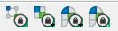
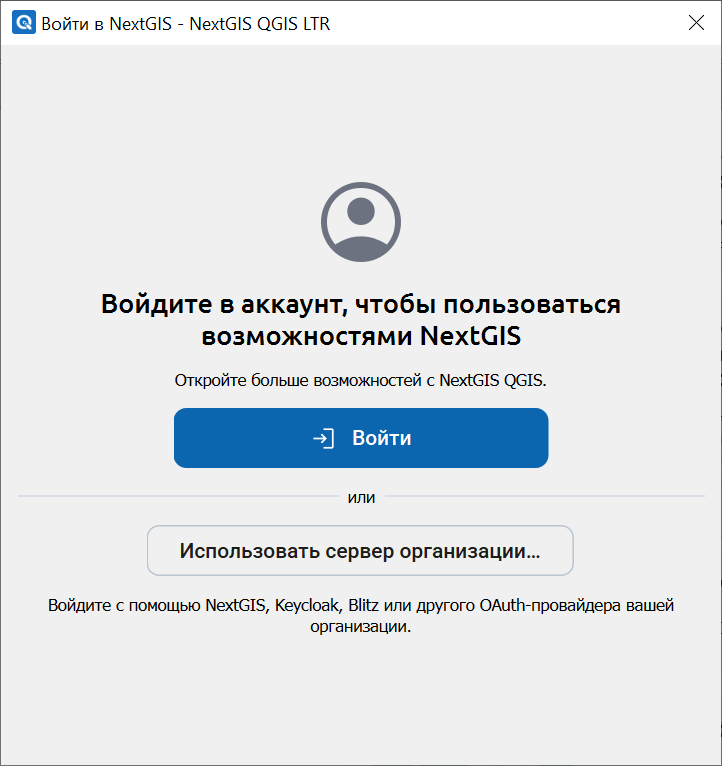
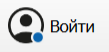
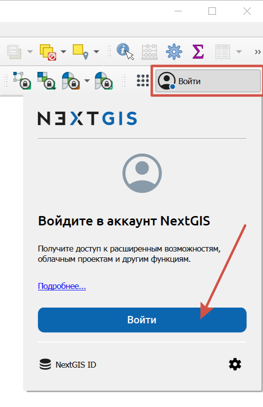
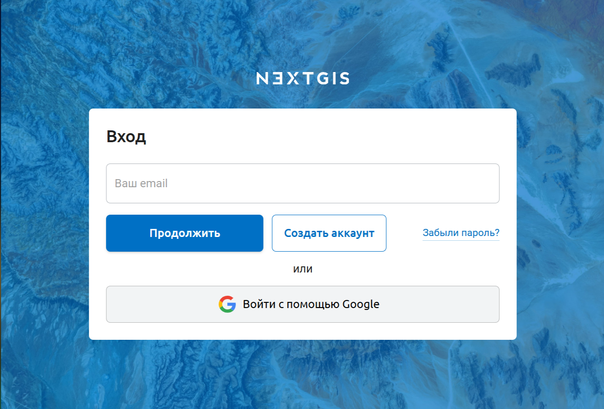
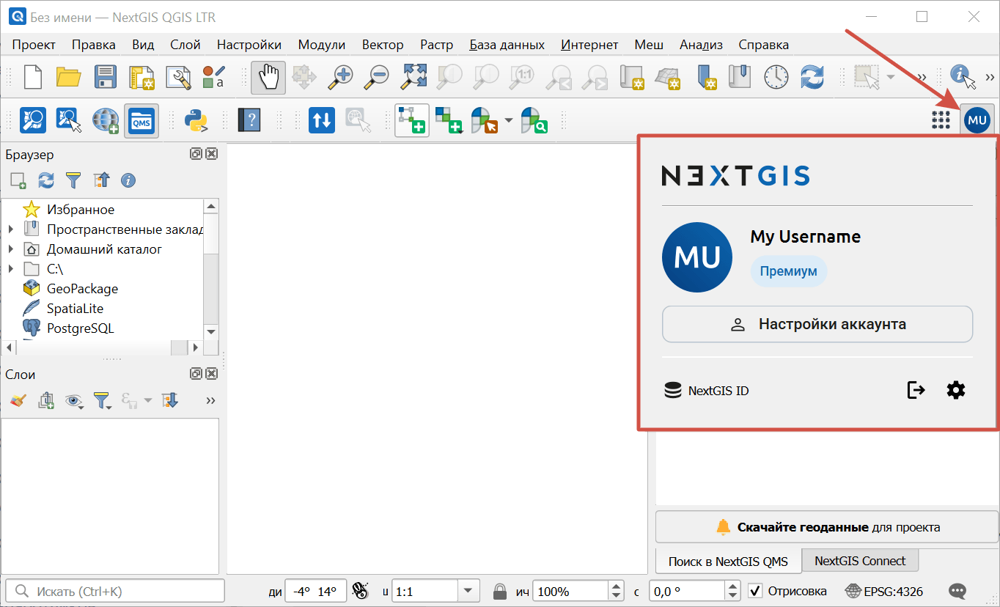
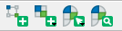
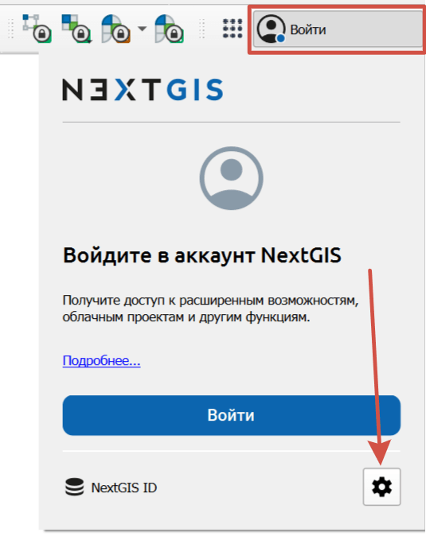
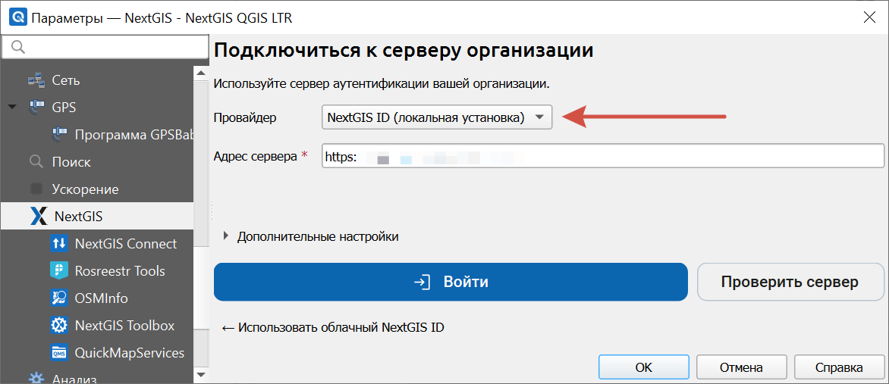

.. _ngqgis_auth:

Авторизация
===========

При открытии программы диалог авторизации появится автоматически. Вы можете его пропустить и вызвать позже при помощи кнопки "Войти".

Поддерживается авторизация через облачный сервер и через собственный сервер авторизации.

Через облачный сервер NextGIS ID (my.nextgis.com)
-------------------------------------------------

Чтобы открыть дополнительные функциональные преимущества :program:`NextGIS QGIS`, 
необходимо приобрести план `Mini или Premium <http://nextgis.ru/nextgis-com/plans>`_ и авторизоваться в программе. Пользователь на бесплатном плане может получить доступ к функционалу, если он `добавлен в команду <https://docs.nextgis.ru/docs_ngcom/source/teams.html#ngcom-team-management>`_.

По умолчанию заблокированные инструменты показываются так: |blocked_tools|.

При открытии программы нажмите **Войти** в приветственном диалоге. 

   Диалог входа при открытии программы

Если приветственный диалог закрыт, нажмите кнопку |not_auth| в NextGIS Account Toolbar на панели инструментов. Во всплывающем меню нажмите кнопку "Войти".

   Вход в аккаунт через NextGIS Account Toolbar

Откроется окно браузера, где вам нужно будет ввести электронную почту, на которую вы `создали аккаунт NextGIS ID <https://docs.nextgis.ru/docs_ngcom/source/create.html#nextgis-id>`_, и пароль.

   
   Страница авторизации NextGIS ID

Если вы забыли данные вашего аккаунта, то `восстановите <https://docs.nextgis.ru/docs_ngcom/source/faq_webgis.html#ngcom-change-passwords-webgis>`_ к нему доступ.

После корректного указания адреса электронной почты и пароля вы получите сообщение об успешной авторизации в NextGIS QGIS, и доступ к Pro-функциям будет разблокирован |ublocked_tools|.

Кнопка NextGIS Account Toolbar  изменится на аватар пользователя (если аватар не задан, отображаются инициалы), при нажатии показывается информация о подписке.

   
   Общий вид NextGIS QGIS. NextGIS Account Toolbar активирован

   
   
Через собственный сервер (NGIDOP)
---------------------------------

.. note:: 
   Необходимо, чтобы на рабочих местах, где установлен NextGIS QGIS с модулем `Rosreestr Tools <https://docs.nextgis.ru/docs_rosreestr_tools/source/index.html>`_ открывался адрес с доменным именем geoservices.nextgis.com.
   Дополнительно вы также можете прописать разрешение на доступ к этому серверу (geoservices.nextgis.com) на сервере, где развернут NextGIS Web.

Для авторизации в NextGIS QGIS через свой сервер, необходимо указать соответствующий Endpoint в настройках авторизации.

В приветственном окне :numref:`ngq_sign_in_open_pic` при открытии программы нажмите **Использовать сервер организации**. 

   Диалог входа при открытии программы

Если вы уже закрыли приветственное окно, нажмите кнопку |not_auth| в NextGIS Account Toolbar на панели инструментов. Во всплывающем меню нажмите шестерёнку. Откроется окно настроек, в котором нужно выбрать **Использовать сервер организации**.

   Переход к настройкам сервера авторизации

В настройках в разделе Провайдер выберите из выпадающего меню **NextGIS ID (локальная установка)** и впишите адрес вашего сервера авторизации.

   
   Добавление собственного сервера авторизации
   
Чтобы проверить правильность ввода данных, нажмите **Проверить сервер**.

Если связь с сервером устанавливается успешно, нажмите **Войти** и в браузере введите логин и пароль, выданные вам администратором.

После корректного указания адреса электронной почты и пароля вы получите сообщение об успешной авторизации в NextGIS QGIS, и доступ к Pro-функциям будет разблокирован |ublocked_tools|.

Кнопка NextGIS Account Toolbar  изменится на аватар пользователя (если аватар не задан, отображаются инициалы), при нажатии показывается информация о сервере авторизации.

.. admonition:: Как открыть настройки сервера авторизации через меню

  Главное меню -> Настройки -> Параметры -> NextGIS
