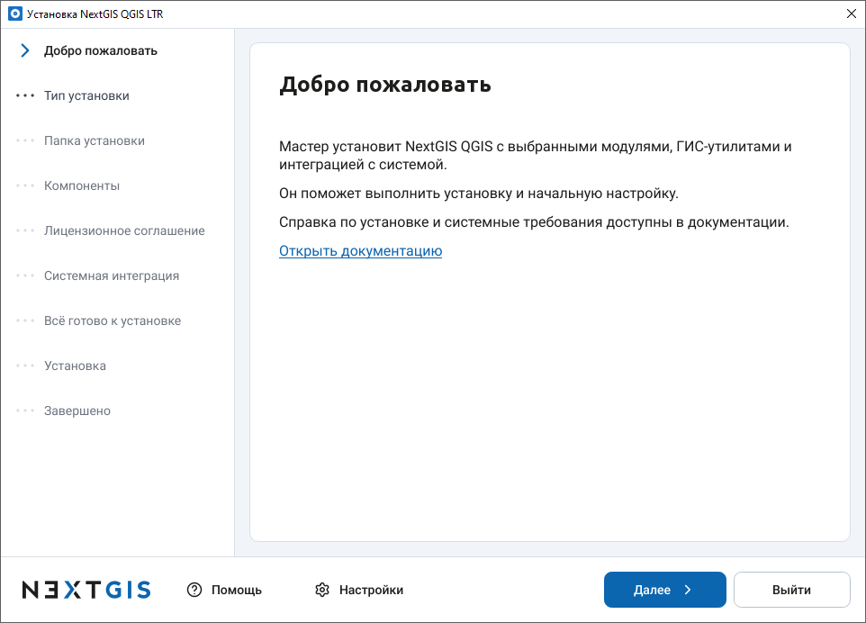
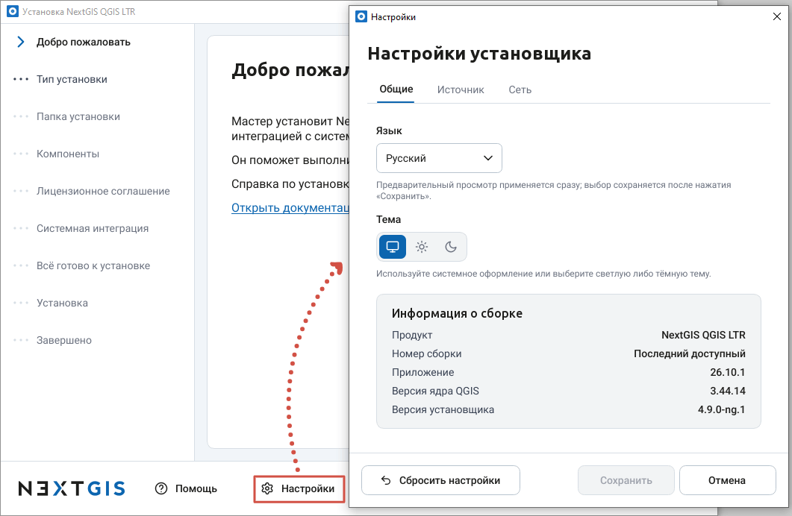
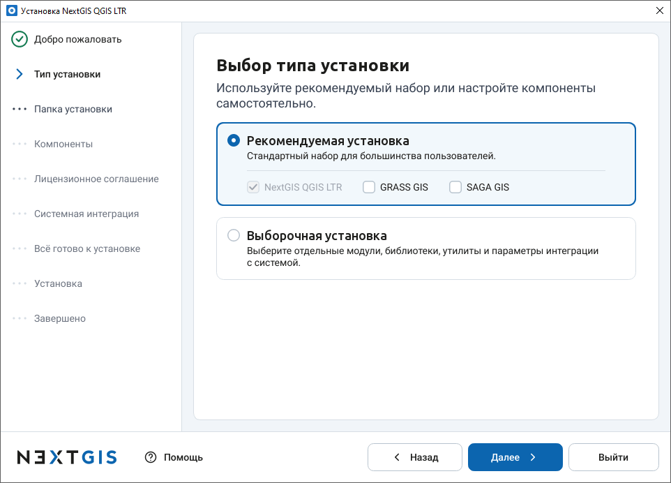
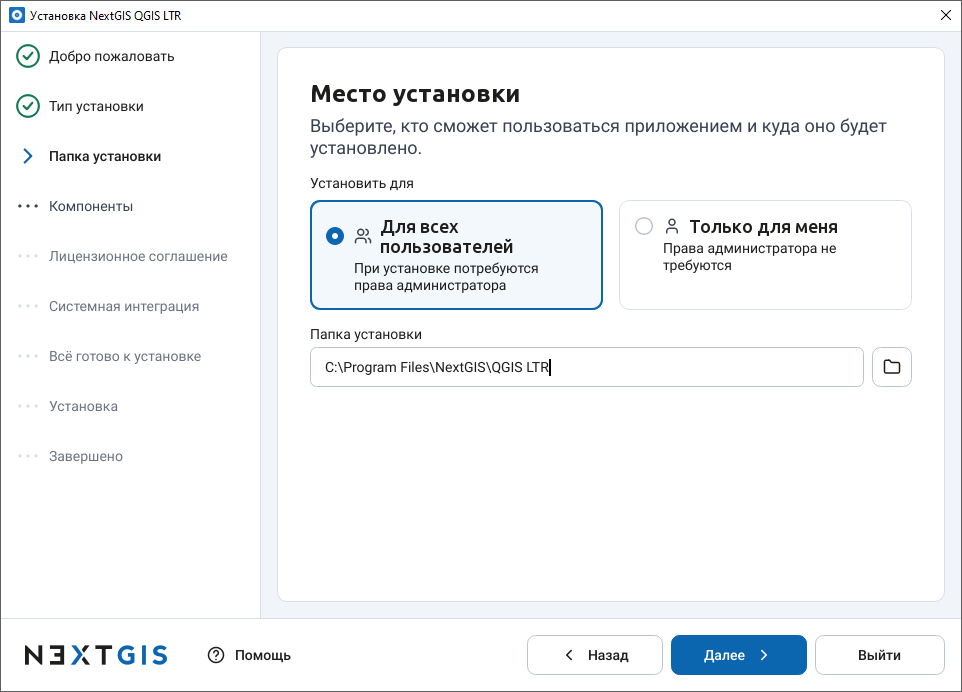
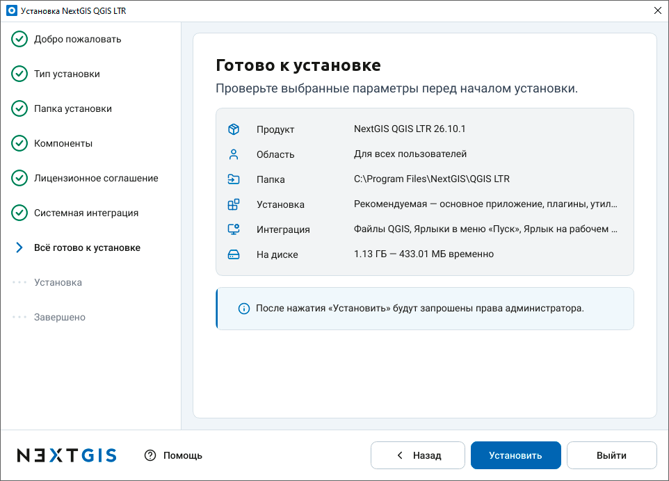
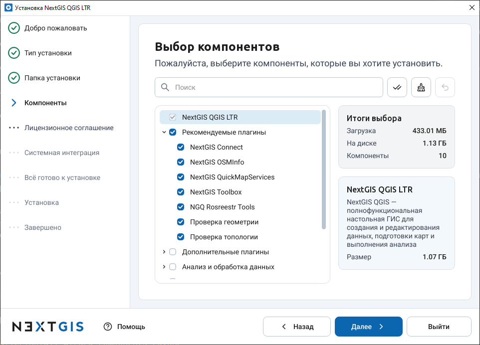
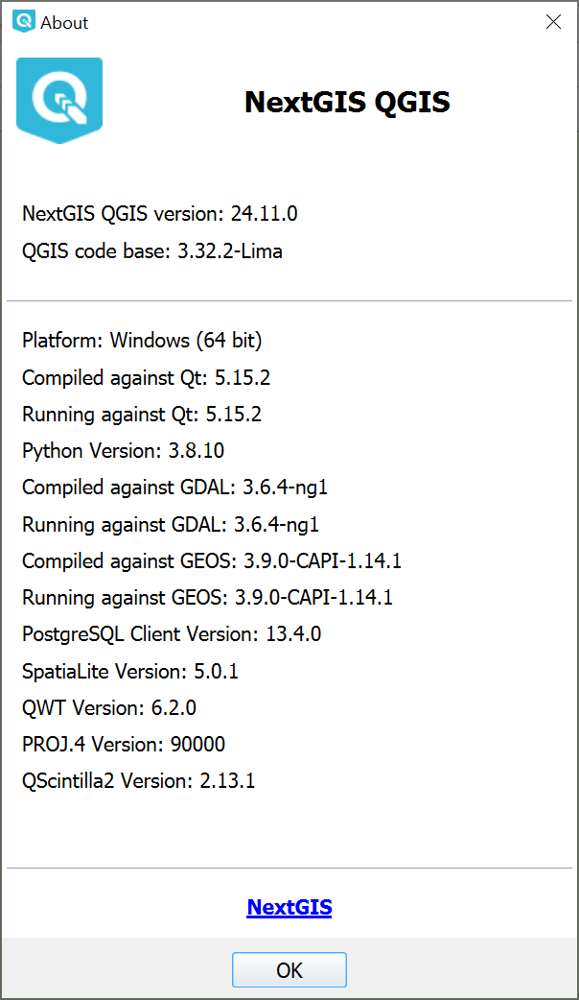
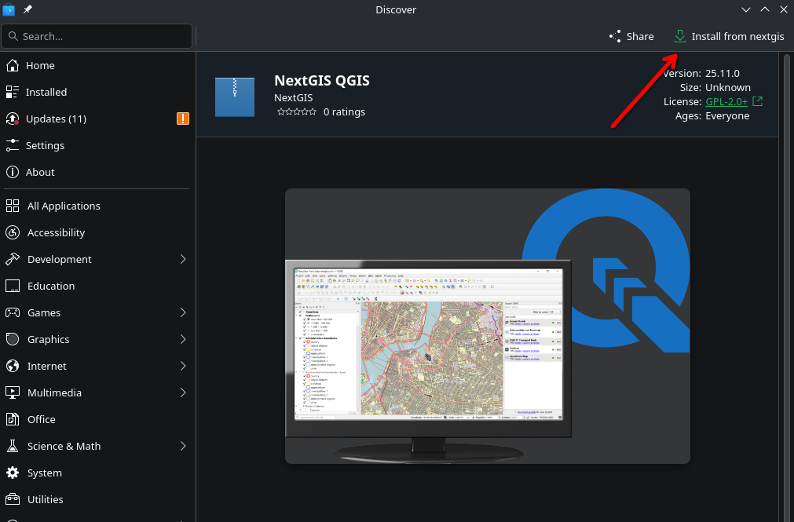

Установка и обновление
=======================

Для установки :program:`NextGIS QGIS` используется универсальный сетевой установщик, который можно скачать `по ссылке <http://nextgis.ru/nextgis-qgis/>`_ или **Flatpak** для операционных систем Linux. В личном кабинете также доступен `оффлайн-инсталлятор <https://my.nextgis.com/software>`_.

Ниже приведены инструкции по установке для операционных систем `Windows <https://docs.nextgis.ru/docs_ngqgis/source/install.html#windows>`_ и `Linux <https://docs.nextgis.ru/docs_ngqgis/source/install.html#linux>`_.

.. _install_windows:

Windows
--------

.. _ngqgis_sys_req:

Системные требования 
^^^^^^^^^^^^^^^^^^^^

Минимальные параметры ПК
~~~~~~~~~~~~~~~~~~~~~~~~~

* ОС Windows 10 и выше, 64 бит
* процессор Intel Core i3 с тактовой частотой не менее 2 ГГц (2 ядра) или аналог
* оперативная память не менее 4 ГиБ
* соответствующая материнская плата для выбранных процессоров со встроенной видеокартой
* накопитель на жестких магнитных дисках емкостью не менее 40 ГБ
* манипулятор “мышь”
* клавиатура
* монитор LCD 14”, разрешение 1024х768

Рекомендуемые параметры ПК
~~~~~~~~~~~~~~~~~~~~~~~~~~

* ОС Windows 10 и выше, 64 бит
* процессор Intel Core i5 с тактовой частотой не менее 2.8 ГГц (4 ядра) или аналог
* оперативная память не менее 16 ГиБ
* соответствующая материнская плата для выбранных процессоров 
* дискретная видеокарта с объемом видео памяти не менее 4 ГиБ
* накопитель на жестких магнитных дисках или SSD емкостью не менее 500 ГБ
* манипулятор “мышь”
* клавиатура
* источник бесперебойного питания емкостью не менее 800 ВА
* монитор LCD 24”, разрешение 2560x1440

.. _ngqgis_install:

Установка на Windows
^^^^^^^^^^^^^^^^^^^^^

Установщик представляет собой пошаговый мастер. Первая страница мастера содержит приглашение к началу установки.

   Начальная страница мастера установки

Здесь вы можете поменять язык, если он определился неправильно, и переключить тему оформления на более удобную: тёмную или светлую. Для этого нажмите на шестерёнку.

   Настройки мастера установки

На второй странице необходимо выбрать один из двух вариантов установки:

* Рекомендуемая установка - Готовый набор для большинства пользователей: NextGIS QGIS, плагины и утилиты, ассоциации файлов QGIS и форматов геоданных, ярлыки в меню «Пуск» и на рабочем столе.
* Выборочная установка - позволяет настроить состава поставки: подключение или исключение необязательных компонентов, дополнительные ассоциации файлов и добавление инструментов в PATH.

При варианте "Рекомендуемая установка" можно сразу добавить два популярных дополнительных компонента: инструменты GRASS и SAGA.

   Стандартный набор компонентов установки

На следующем шаге нужно указать путь до папки установки. Рекомендуется оставить предложенный мастером путь. Также вы можете выбрать, хотите ли вы установить программу для всех пользователей, или только для конкретного.

   Выбор папки для установки

Если вы выбрали рекомендуемую установку, то после этого шага вы сразу перейдёте к странице "Готово к установке". 

Мастер сообщит о готовности начать установку. 

   Все настройки произведены, программа готова к установке
   
После нажатия кнопки **Установить** начнётся процесс распаковки и установки файлов.
По окончании этого процесса появится финальное окно с сообщением об успешной установки программы.

При **выборочной установке** на четвёртой странице можно настроить, какие компоненты устанавливать.

   Выбор компонентов для установки

На пятой странице мастера принимается лицензионное соглашение.

На шестой странице настраивается интеграция с системой:

* Открывать файлы проектов QGIS в NextGIS QGIS (пункт будет добавлен в меню "Открыть с помощью").
* Открывать файлы геоданных в NextGIS QGIS.
* Создать ярлыки: в меню "Пуск", на рабочем столе.
* Разрешить запуск установленных приложений и командных инструментов из любого терминала.

.. _ngqgis_update:

Обновление на Windows
^^^^^^^^^^^^^^^^^^^^^

Процесс обновления зависит от установленной версии программы.

.. _ngqgis_update_check:

Как проверить текущую версию программы
~~~~~~~~~~~~~~~~~~~~~~~~~~~~~~~~~~~~~~

Запустите NextGIS QGIS и перейдите в ``Справка  ‣ О программе``.

   Проверка установленной версии NextGIS QGIS

Если ваша версия 25 и ниже, то вам нужно установить программу заново, обновление с этой версии не поддерживается.

.. _ngqgis_update_26:

Обновление компонентов для версии 26 и выше
~~~~~~~~~~~~~~~~~~~~~~~~~~~~~~~~~~~~~~~~~~~

Перейдите в режим обслуживания (это можно сделать, запустив файл установщика). Здесь вы можете:

* Добавить или удалить отдельные компоненты, например, подключить инструменты SAGA GIS;
* Обновить установленные компоненты;
* Удалить все компоненты и деинсталлировать программу.

.. figure:: _static/ngq_maintanance_ru.png
   :name: ngq_check_version_pic
   :align: center
   :width: 20cm

   Обслуживание программы

.. _console:

Консольная (“тихая”) установка NextGIS QGIS на Windows
-------------------------------------------------------

Основой для инсталлятора настольного ПО является установщик  **Qt installer framework**. Он позволяет выполнять установку как через графический интерфейс, так и из командной строки.  

Подробная информация приведена на `doc.qt.io <http://doc.qt.io>`_.  Запуск из командной строки описан в разделах `Command Line Interface <https://doc.qt.io/qtinstallerframework/ifw-cli.html>`_ и `Using from Command Line <https://doc.qt.io/qtinstallerframework/ifw-use-cases-cli.html>`_.

Получить краткую справку можно через аргумент --help:

.. code::

   .\nextgis-setup-win64.exe --help

Для того, чтобы отобразить список всех компонентов, доступных для установки, необходимо выполнить: 

.. code::

   .\nextgis-setup-win64.exe search

 
Команда поддерживает различные флаги фильтрации (описаны в `документации <https://doc.qt.io/qtinstallerframework/ifw-cli.html>`_).

Для самой установки используется команда **install**. Опционально можно указать путь и список компонентов:

.. code::

   .\nextgis-setup-win64.exe install --accept-licenses --root “C:\NextGIS”

Полный список параметров приведён в документации.

Рекомендуем обратить внимание на раздел `Unattended Usage <https://doc.qt.io/qtinstallerframework/ifw-use-cases-cli.html#unattended-usage>`_, он описывает установку одной командой, без дополнительных диалогов.

Для примеров выше используется **stable**-установщик, но можно использовать тот же подход и со **standalone**.

Для **обновления** NextGIS QGIS из консоли используйте **nextgisupdater.exe** (находится в корне установленного QGIS).  Набор его команд аналогичен описанному выше установщику.

.. _install_linux:

Linux
-----

.. _ngqgis_install_linux:

Установка на Linux
^^^^^^^^^^^^^^^^^^

Актуальным способом распространения NextGIS QGIS в Linux сейчас является Flatpak. У нас развёрнут репозиторий по адресу flatpak.nextgis.com. Данная инструкция описывает установку и обновление при наличии доступа в интернет. 

1. Установка Flatpak

Установите Flatpak способом, используемым в вашей ОС: 

* `ALT Linux <https://www.altlinux.org/Flatpak>`_
* `РЕД ОС <https://redos.red-soft.ru/base/redos-7_3/7_3-administation/7_3-isolated-env/7_3-flatpak/>`_
* `Astra Linux <https://wiki.astralinux.ru/kb/osnovy-ispol-zovaniya-flatpak-205885327.html>`_ 
* Другие ОС можно найти в `списке <https://flathub.org/ru/setup>`_

2. Установка NextGIS QGIS

Самый простой способ установки — использовать файл com.nextgis.ngqgis.flatpakref.
Его можно открыть в установщике или передать как аргумент команде flatpak install

.. _install_linux_graph:

Установка с помощью графического интерфейса
~~~~~~~~~~~~~~~~~~~~~~~~~~~~~~~~~~~~~~~~~~~

#. Скачайте файл `com.nextgis.ngqgis.flatpakref <https://flatpak.nextgis.com/repo/appstream/com.nextgis.ngqgis.flatpakref>`_
#. Откройте файловый менеджер и перейдите в каталог загрузок
#. Откройте com.nextgis.ngqgis.flatpakref в установщике, например, KDE Discover (в окружении KDE) или Gnome Software (в окружении Gnome)
#. Нажмите **установить**

.. _install_linux_terminal:

Установка с помощью терминала
~~~~~~~~~~~~~~~~~~~~~~~~~~~~~

Откройте терминал и выполните команду

.. code-block::

   flatpak install https://flatpak.nextgis.com/repo/appstream/com.nextgis.ngqgis.flatpakref

В процессе будет предложено добавить репозитории NextGIS и Flathub, если они ещё не были настроены.

Вы также можете установить NextGIS QGIS только для текущего пользователя, если это требуется для рабочего процесса. Для этого передайте флаг --user в команду install:

.. code-block::

   flatpak install --user https://flatpak.nextgis.com/repo/appstream/com.nextgis.ngqgis.flatpakref

.. _ngqgis_update_linux:

Обновление на Linux
^^^^^^^^^^^^^^^^^^^

Если у вас ранее была установлена оффлайн-версия NextGIS QGIS, предварительно нужно её удалить с помощью команды flatpak uninstall com.nextgis.ngqgis, и выполнить установку по инструкции выше. 

.. _update_linux_graph:

Обновление с помощью графического интерфейса
~~~~~~~~~~~~~~~~~~~~~~~~~~~~~~~~~~~~~~~~~~~~~

#. Откройте KDE Discover (в окружении KDE) или Gnome Software (в окружении Gnome)
#. В поиске введите NextGIS QGIS
#. Нажмите кнопку **Обновить**

.. _update_linux_terminal:

Обновление с помощью терминала
~~~~~~~~~~~~~~~~~~~~~~~~~~~~~~~

Откройте терминал и выполните команду

.. code-block::

   flatpak update com.nextgis.ngqgis

