.. _ngqgis_map_composer:

Макет карты для печати и экспорта в растровое изображение
===============================================================

Карту, созданную в :program:`NextGIS QGIS`, можно распространять как изображение: распечатать, сохранить в формате PDF, SVG или как растровое изображение.

.. seealso::
   Другой удобный способ поделиться данными - `создать интерактивную веб-карту <https://docs.nextgis.ru/docs_howto/source/quick_webmap.html>`_
  
Для оформления и подготовки макета карты или `атласа <https://docs.nextgis.ru/docs_ngqgis/source/map_composer.html#ngqgis-map-composer-atlas>`_ используется Компоновщик карты. Компоновщик карты предоставляет возможности вёрстки (размещения карт легенд и других объектов на листе) и печати. Он позволяет добавлять стандартное оформление карты (масштабные линейки, сетку), список условных обозначений и другие изображения и таблицы.

Процесс создания макета подробно рассматривается ниже. Также он представлен в видео:

.. raw:: html

   <iframe width="560" height="315" src="https://rutube.ru/play/embed/745fbe3a1374cae43053e4b4b74dacf3/" frameBorder="0" allow="clipboard-write; autoplay" webkitAllowFullScreen mozallowfullscreen allowFullScreen></iframe>

Посмотреть видео на `YouTube <https://youtu.be/mj5vO7kPTMc>`_, `RuTube <https://rutube.ru/video/745fbe3a1374cae43053e4b4b74dacf3/>`_.

Макеты хранятся внутри проекта. Для одного проекта можно создавать несколько разных макетов.

.. _ngqgis_map_composer_export:

Как подготовить карту к экспорту или печати
--------------------------------------------

Перед началом работы в компоновщике карты нужно добавить в :program:`NextGIS QGIS` нужные слои и настроить их оформление. 

Когда в основном окне карта отображается так, как вам нужно, нажмите :menuselection:`Проекты ‣ Создать макет`.

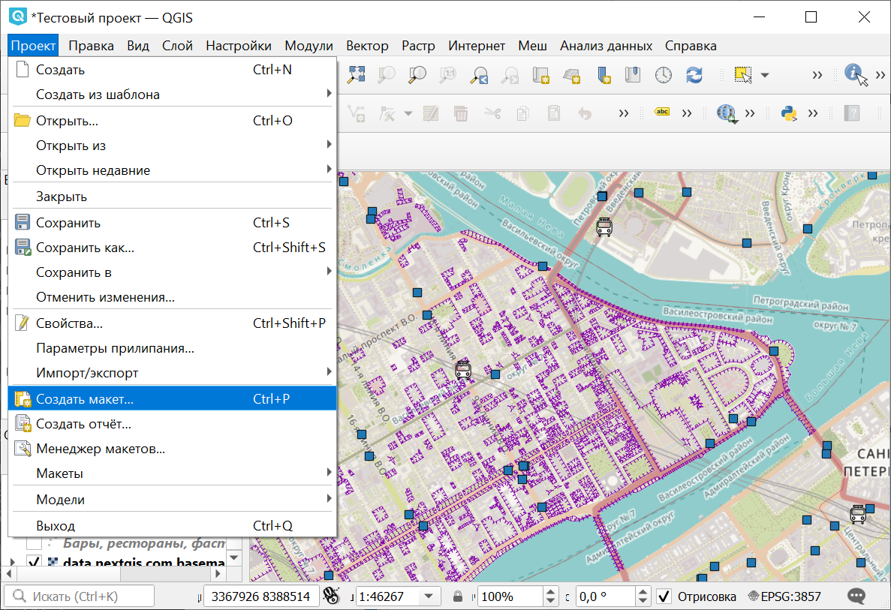

   Запуск компоновщика карты через меню

Можно ввести имя для макета или оставить поле пустым, тогда имя будет сгенерировано автоматически. 

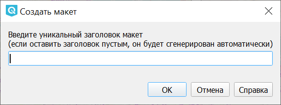

   При запуске нажмите "ОK"

Нажмите кнопку |button_add_map| **Добавить карту** и начертите прямоугольник в области карты.

Выделите карту в области компоновки: щёлкните на неё инструментом |button_select_move| "Выделить/переместить элемент" и проверьте, рисуются ли квадратики по бокам элемента. 

Откройте вкладку "Свойства элемента". Настройте **охват** карты с масштабом и набор слоёв. 

Для сдвига охвата - выделите карту инструментом |button_select_move| "Выделить/переместить элемент", затем выберите инструмент |button_move_content| "Переместить содержимое элемента". Нажмите и ведите по карте мышкой - карта будет сдвигаться. 

Для изменения **масштаба** карты вращайте колесо мыши. Если вращать с нажатой клавишей :guilabel:`Control`, масштаб будет меняться с меньшим шагом. 

На вкладке "Свойства элемента" можно:

* ввести точное значение масштаба с клавиатуры в поле "Масштаб".
* |button_SetToCanvasExtent| установить масштаб как у текущего окна карты

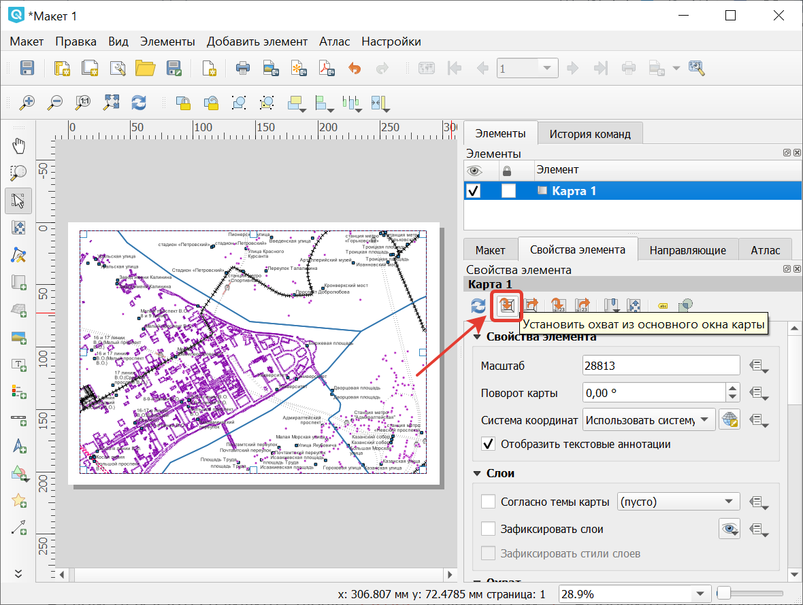
   
   Установить масштаб из основного окна

Посмотрите, как работает настройка масштаба, в видео:

.. raw:: html

   <iframe width="560" height="315" src="https://rutube.ru/play/embed/5cf56724cd0ef70d78477c77c4527ab4/" frameBorder="0" allow="clipboard-write; autoplay" webkitAllowFullScreen mozallowfullscreen allowFullScreen></iframe>

Посмотреть видео на `youtube <https://youtu.be/_U1bwdwgh60>`_, `rutube <https://rutube.ru/video/5cf56724cd0ef70d78477c77c4527ab4/>`_.

Охват сохраняется в макете, и изменения в основном окне NextGIS QGIS на него не влияют: вы можете в основном окне двигать карту, а в макете она останется такой же. 

Результат можно экспортировать: 

* |button_as_image| в изображение;
* |button_as_svg| в SVG;
* |button_as_pdf| в PDF.

Для экспорта нажмите соответствующую кнопку в панели иснтрументов и задайте имя файла, чтобы сохранить результат. 

Многостраничный макет может быть сохранён как в виде отдельных изображений с номерами, так и в виде многостраничного PDF.

Ниже вы найдёте более подробную информацию об элементах, которые можно добавить в макет, и его настройке.

.. admonition:: Хотите научиться делать макеты карт с врезками, изображениями и другими дополнительными элементами?

  Вам поможет наш курс `Фундаментальный QGIS <https://nextgis.skillspace.ru/l/qgis>`_. Он включает в себя видеоуроки, данные и задания для самостоятельной работы, есть тариф с обратной связью.

.. _ngqgis_map_composer_ui:

Основные инструменты компоновщика карты
----------------------------------------

При открытии нового макета посередине располагается белая область компоновки карты, изображающая лист бумаги. 

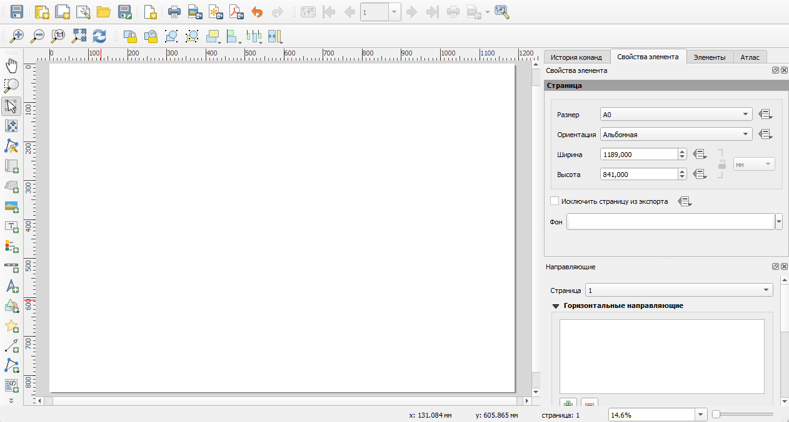
   
   Окно компоновщика карты

В панели слева расположены основные кнопки инструментов:

- |button_pan_hand| Прокрутка макета - "рука"
- |button_zoom_to_area| Приблизить макет
- |button_select_move| Выделить/переместить элемент
- |button_move_content| Сдвинуть содержимое внутри рамки элемента
- |button_edit_shape| Редактировать произвольную фигуру

И кнопки добавления элементов:

- |button_add_map| Добавить карту
- |button_add_3dmap| Добавить 3D-карту
- |button_add_picture| Добавить изображение
- |button_add_label| Добавить надпись
- |button_add_legend| Добавить легенду
- |button_add_scalebar| Добавить масштабную линейку
- |button_add_north| Добавить указатель «север-юг»
- |button_add_shape| Добавить фигуру
- |button_add_marker| Добавить маркер
- |button_add_arrow| Добавить стрелку
- |button_add_html| Добавить HTML
- |button_add_attrtable| Добавить таблицу атрибутов
- |button_add_table| Добавить произвольную таблицу

Чтобы добавить элемент, нажмите соответствующую кнопку и затем нарисуйте рамку элемента на листе или кликните в нужном месте.

Вы можете масштабировать, перемещать и поворачивать каждый элемент и объединять элементы в группы.

Панели
-------

Справа находятся панели:

* Элементы - список добавленных на карту элементов. Вы можете преключаться между элементами, используя эту панель или кликая по нима на макете.
* История команд - позволяет отменять последние действия.
* Макет - общие свойства макета, например, разрешение экспортируемого изображения в :abbr:`dpi (dot per inch)`.
* Свойства Элемента - настройки выделенного элемента, содержимое этой вкладки зависит от типа элемента.
* Направляющие - позволяет добавить пунктирные линии для выравнивания элементов макета.
* Атлас - появляется при выборе режима создания Атласа (подробнее см. ниже).

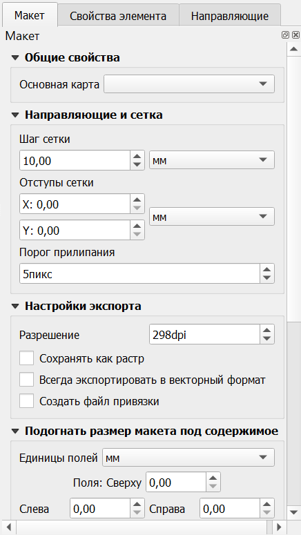

   Вкладка "Макет"
   
Ниже рассматриваются свойства некоторых популярных элементов макета.

Условные обозначения (легенда)
~~~~~~~~~~~~~~~~~~~~~~~~~~~~~~~~

Легенда добавляется кнопкой |button_add_legend| из панели элементов.

Легенда обновляется автоматически при изменении проекта. В свойствах легенды можно выключить автоматическое обновление и переименовать или убрать из неё ненужные слои.

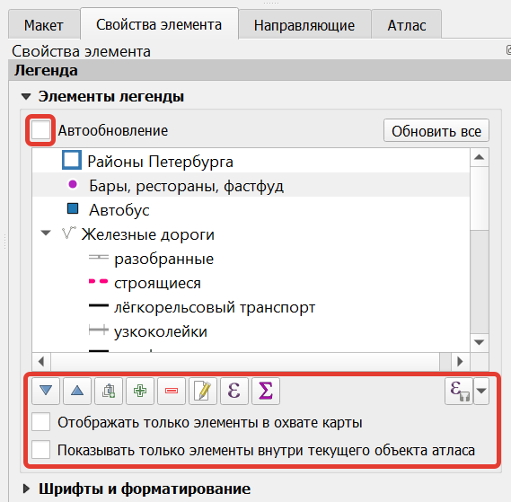
   
   Кнопки управления легендой, доступные при снятом флажке "Автообновление"

Комбинация и порядок слоёв, а так же стили по умолчанию не сохраняются: если вы их переставите в основном окне, то в макете они поменяются. Но их изменение можно заблокировать в свойствах элемента, поставив флажок в пунктах "Зафиксировать слои" и "Зафиксировать стили слоев".

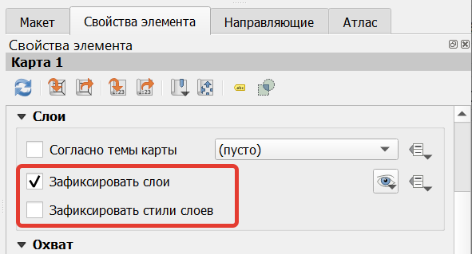
   
   Блокировка слоев карты в компоновщике
   

Масштабная линейка
~~~~~~~~~~~~~~~~~~~~

Чтобы добавить масштабную линейку, выберите |button_add_scalebar| в панели элементов слева.

При добавлении масштабной линейки необходимо проверить в свойствах проекта выбор эллипсоида для вычислений (:menuselection:`Проект --> Свойства --> Общие --> Измерения --> Эллипсоид`). 
Если вы не знаете, какой должен быть - укажите там WGS 84.

Для масштабной линейки можно настроить стиль (стандартная "зебра", линия со штрихами, только цифры масштаба и др) и отображение единиц измерения. Также можно указать, для какой части карты рассчитывается масштаб, отображаемый на линейке. Это имеет значение, если используется проекция с сильными искажениями. 

Название карты и другие надписи
~~~~~~~~~~~~~~~~~~~~~~~~~~~~~~~

Заголовок карты можно добавить при помощи инструмента |button_add_label|.

.. warning::
   При экспорте карты принято добавлять текст с ссылками на источники картографических данных.

.. _ngqgis_map_composer_atlas:

Атлас
--------

Эта функция создаёт набор изображений с одинаковым макетом, но с разными участками карты. 
Вам понадобится векторный слой охвата, который содержит геометрии и поля, например слой границ районов города. Каждому объекту будет соответствовать страница атласа.

Подготовка слоя покрытия
~~~~~~~~~~~~~~~~~~~~~~~~~

Слой покрытия будет определять месторасположение листов атласа. 

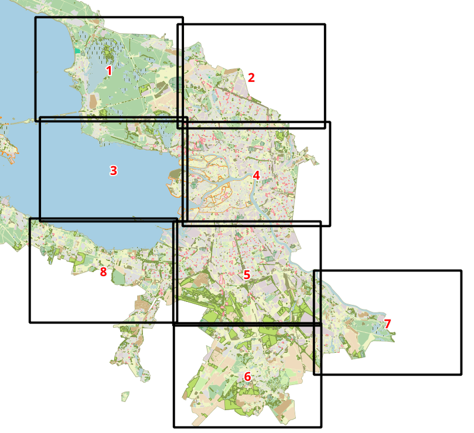

   Вариант расположения листов атласа с использованием полигонов. Размер каждого прямоугольника подобран под размер листа A0

В качестве слоя покрытия может выступать любой векторный слой карты, тогда количество листов атласа будет определяться числом объектов в слое, центр листа атласа - центроидом каждого объекта, масштаб - размером объекта.

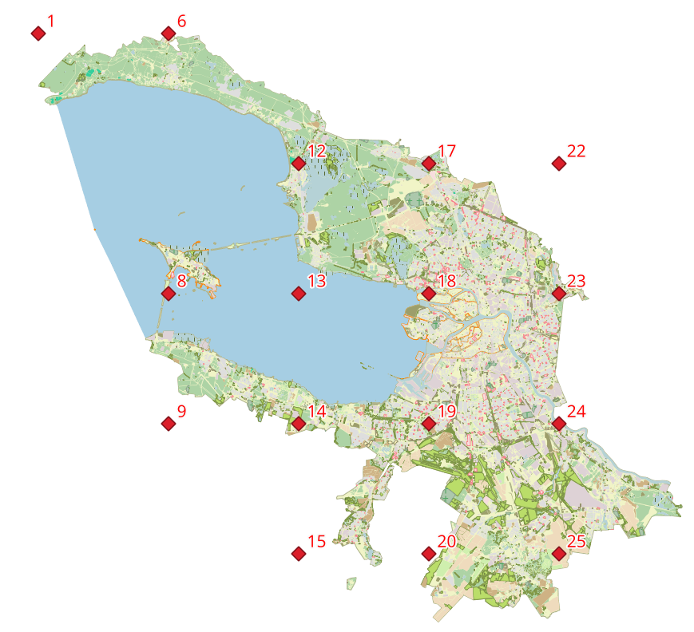

   Вариант расположения листов атласа через точки - центры листов

Добавление карты в макет
~~~~~~~~~~~~~~~~~~~~~~~~

Откройте новый макет :menuselection:`Проект --> Создать макет`.

Установите размер страницы исходя из размеров одного листа атласа (не всей карты целиком!), например, А0.

   Настройка размера листа

Добавьте на лист элемент **Карта**.

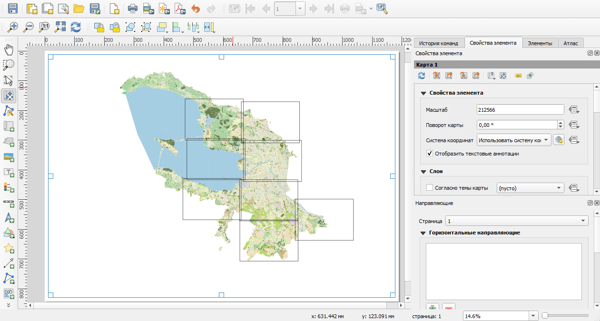

   Добавлена карта

Установите масштаб карты, соответствующий примерному масштабу листа атласа. На листе не будет отображаться вся карта целиком - это не имеет значения.

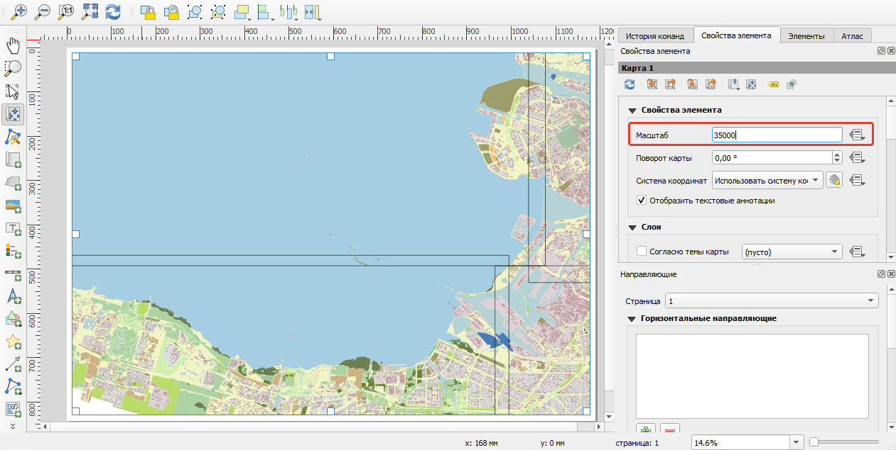

   Установка основного масштаба

Настройка атласа
~~~~~~~~~~~~~~~~~

Вызовите панель Атлас, нажав в верхнем меню компоновщика карт :menuselection:`Атлас --> Настройки атласа`.

Активируйте флажок "Создать атлас". Ниже в разделе "Параметры" выберите слой покрытия.  Объекты из этого слоя будут определять границы и масштаб листов атласа.

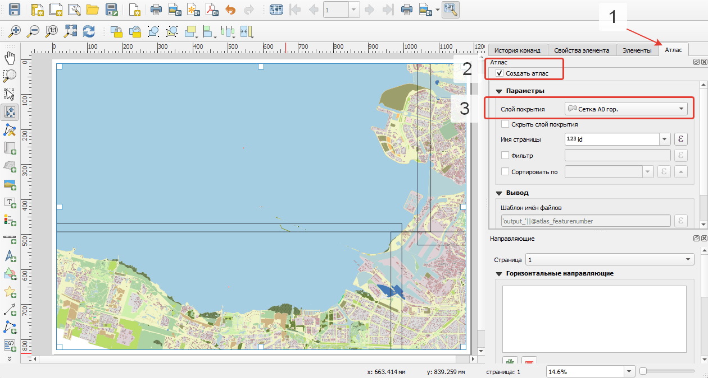
   
   Вкладка "Атлас" с выбранным слоем охвата

Вернитесь обратно в свойства элемента "Карта", чтобы настроить масштаб листа атласа.

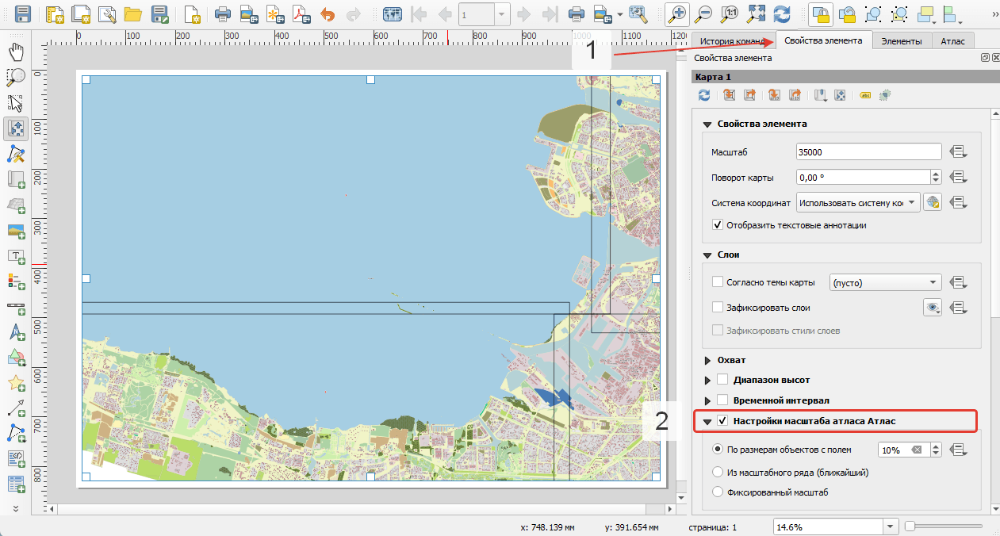

   Настройка масштаба листа атласа

Выберите принцип масштабирования листа атласа. В QGIS можно использовать 3 подхода:

* **По размерам объектов с полем** - масштаб каждого листа атласа подбирается таким образом, чтобы в него вписался объект из слоя покрытия, определяющий границы листа (в примере это прямоугольник) с заданным отступом вокруг него;
* **Из масштабного ряда (ближайший)** - программа подбирает ближайший “целый” картографический масштаб (1:500, 1:1000, 1:5000 и т.д.) , чтобы в него вписался объект из слоя покрытия;
* **Фиксированный масштаб** - определяется масштабом самой карты (см. :numref:`layout_atlas_scale_pic`)  При этом варианте все листы карты будут иметь одинаковый масштаб, вне зависимости от реальных размеров объектов слоя покрытия.

Как выглядят разные варианты масштабирования для нашего примера:

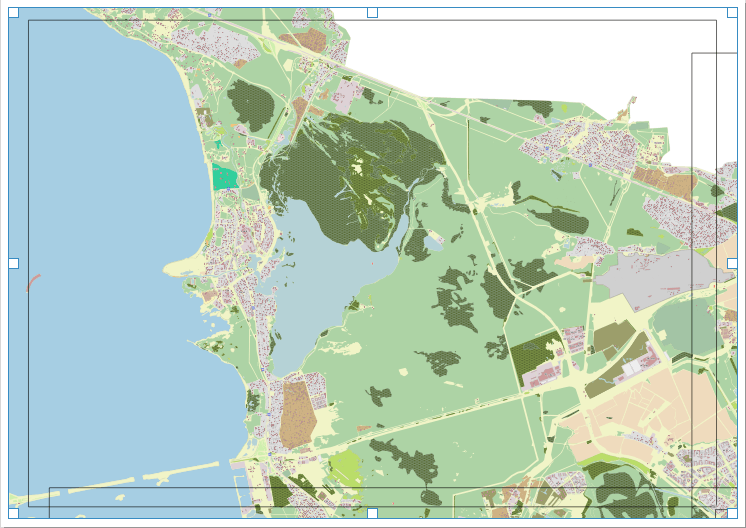

   По размерам объектов с полем с 5% перекрытием -  1:37835

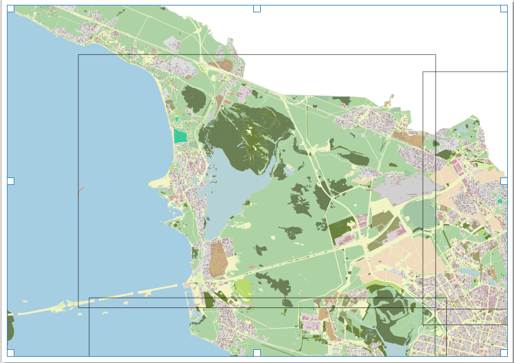

   С автоматическим подбором ближайшего картографического масштаба - 1:50 000

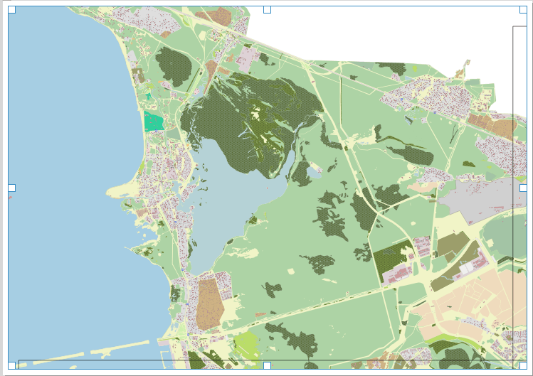

   С указанием фиксированного масштаба - 1:35 000

Чтобы перейти в режим предварительного просмотра листов атласа, нажмите |button_atlas_preview| на панели инструментов.

Доступны три вида экспорта: 

* |button_as_image| в изображение - будет создано много изображений в одной папке, по одному на каждый лист атласа;
* |button_as_svg| в SVG;
* |button_as_pdf| в PDF - можно создать по одному PDF на каждый лист атласа или один многостраничный.

Для сохранения результатов нажмите соответствующую кнопку на панели инструментов или в верхнем меню Атлас.

.. admonition:: Более продвинутый вариант использования: 

  Поля слоя охвата могут быть использованы в выражениях фильтра слоя или в выражении в стилях. Например, можно нагенерировать атлас районов города, где подписи улиц будут печататься только в том районе, который показан на странице. 

.. todo::
   можно сделать атлас районов области, можете нагенерить регулярную сетку с номерами. 

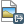
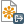
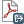

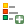
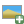
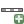
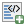

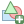
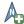
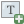
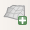

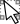
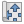
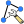
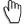

