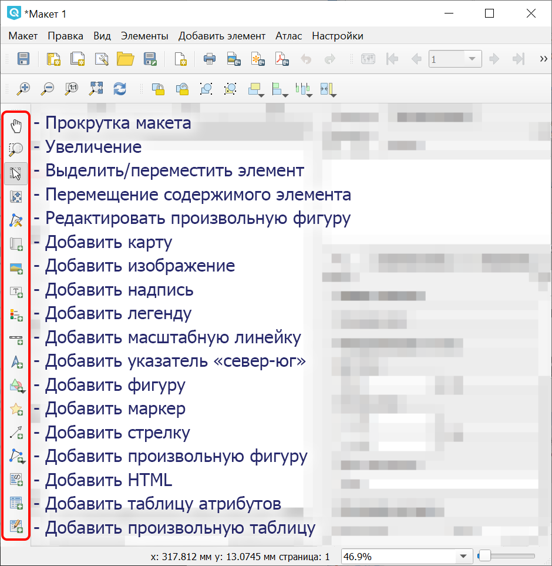
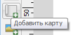
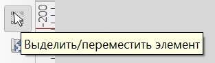
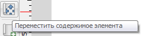
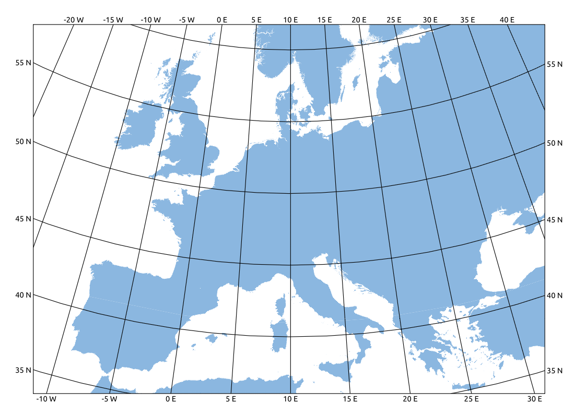

.. _ngqgis_map_composer:

Макет карты для печати и экспорта в растровое изображение
===============================================================

Географическую информацию, созданную в :program:`NextGIS QGIS`, можно распространять как статическое изображение: распечатать, сохранить в формате PDF, SVG или как растровое изображение.

Для оформления и подготовки макета карты или атласа используется Компоновщик карты. 

.. tip::
   Если же вам нужно показывать интерактивную карту в Интернете, то воспользуйтесь плагином `NextGIS Connect <https://docs.nextgis.ru/docs_ngcom/source/ngqgis_connect.html>`_. 
   

Компоновщик карты предоставляет возможности вёрстки (размещения карт легенд и других 
объектов на листе) и печати. Он позволяет добавлять такие элементы:

1. Карты.
2. Подписи.
3. Картинки.
4. Список условных обозначений.
5. Масштабные линейки.
6. Сетки на карте.
7. Фигуры.
8. Стрелки.
9. Таблицы данных.
10. HTML-фреймы. 

Вы можете масштабировать, группировать, перемещать и поворачивать каждый элемент. 
Макет может состоять из нескольких страниц. Макет можно сохранять в проекте. Так же 
макет может быть использован для генерации `атласа <https://docs.nextgis.ru/docs_ngqgis/source/map_composer.html#ngqgis-map-composer-atlas>`_ - сборника из нескольких карт. 

Процесс создания макета подробно рассматривается ниже. Также он представлен в видео:

.. raw:: html

   <iframe width="560" height="315" src="https://rutube.ru/play/embed/745fbe3a1374cae43053e4b4b74dacf3/" frameBorder="0" allow="clipboard-write; autoplay" webkitAllowFullScreen mozallowfullscreen allowFullScreen></iframe>

Посмотреть видео на `youtube <https://youtu.be/mj5vO7kPTMc>`_, `rutube <https://rutube.ru/video/745fbe3a1374cae43053e4b4b74dacf3/>`_.

.. _ngqgis_map_composer_open:

Открытие компоновщика карты
----------------------------------

.. figure:: _static/composer_start_01_ru.png
   :name: composer_start_01
   :align: center
   :width: 22cm

   Запуск компоновщика карты через меню

.. figure:: _static/composer_start_02_ru.png
   :name: composer_start_02
   :align: center
   :width: 12cm

   При запуске композера нажмите "ОK"

Перед началом работы в компоновщике карты нужно добавить в :program:`NextGIS QGIS` 
нужные слои и настроить их оформление. Когда в 
основном окне карта отображается так, как вам нужно, нажмите ``Проекты ‣ Создать макет``.
В диалоге вам предлагается ввести имя для нового макета карты. Его можно оставить пустым. 

.. _ngqgis_map_composer_ui:

Обзор окна Компоновщика карты
-----------------------------------

При открытии нового окна "Компоновщика карты" в нём будет белая область компоновки карты, изображающая лист бумаги. 
В левой части окна находится панель кнопок, которые добавляют объекты в область компоновки: текущую карту из NextGIS QGIS, надписи, картинки, легенду, масштабные линейки, стрелки, таблицы атрибутов и HTML-фреймы. 
Так же в этой панели находятся кнопки перемещения по области компоновки. 
Это начальный вид окна Компоновщика карты без добавления каких-либо элементов и выполненных команд. 

   
   Окно компоновщика карты

Основные кнопки в компоновщике:

- Прокрутка макета
- Увеличение
- Выделить/переместить элемент
- Перемещение элемента по листу
- Редактировать произвольную фигуру

Добавление элементов:

- |button_add_map| Добавить карту
- |button_add_3dmap| Добавить 3D-карту
- |button_add_picture| Добавить изображение
- |button_add_label| Добавить надпись
- |button_add_legend| Добавить легенду
- |button_add_scalebar| Добавить масштабную линейку
- |button_add_north| Добавить указатель «север-юг»
- |button_add_shape| Добавить фигуру
- |button_add_marker| Добавить маркер
- |button_add_arrow| Добавить стрелку
- |button_add_html| Добавить HTML
- |button_add_attrtable| Добавить таблицу атрибутов
- |button_add_table| Добавить произвольную таблицу

Справа посредине находится панель c 3 вкладками: "Макет", "Свойства Элемента" и "Направляющие". Также при выборе режима создания Атласа (Атлас - Настройки атласа) появляется вкладка "Атлас" (подробнее о создании атласа см. ниже).

.. figure:: _static/composer_layout_tab_ru.png
   :name: composer_maquet
   :align: center
   :width: 10cm

   Вкладка "Макет"
   
   
На вкладке Макет задаются параметры бумаги: формат и соотношение сторон. 
Регулятором Количество страниц можно добавить страницы в макет: их можно сверстать по-разному. 
Регулятором Разрешение задаётся разрешение изображения в :abbr:`dpi (dot per inch)`. 

Содержимое вкладки "Свойства Элемента" бывает разное для каждого выделенного элемента в области компоновки карты. Выделите в ней карту или масштабную линейку инструментом (стрелка) - содержимое вкладки будет другим.

Вкладка "История команд" отображает историю всех изменений, сделаных в макете. 
Здесь можно как отменить сделанные изменения, так и повторить ранее отмененные действия.

Макет сохраняется внутри файла проекта. Макетов может быть несколько.

.. _ngqgis_map_composer_export:

Как подготовить карту к экспорту или печати
--------------------------------------------

1. Нажмите кнопку "Добавить карту".

   Кнопка "Добавить карту"

2. Начертите прямоугольник в области карты.
3. Выделите карту в области компоновки: щёлкните на неё инструментом "Выделить/переместить элемент" и 
   проверьте, рисуются ли квадратики по бокам элемента. 

   Кнопка "Выделить/переместить элемент"

4. Откройте вкладку "Свойства элемента". 
5. Настройте :term:`охват` карты с масштабом и набор слоёв. 

Для сдвига охвата - выделите карту инструментом "Выделить/переместить элемент", 
затем выберите инструмент "Переместить содержимое элемента".
Нажмите и ведите по карте мышкой - карта будет сдвигаться. 

   Кнопка "Переместить содержимое элемента"

Для изменения масштаба карты вращайте колесо мыши. Если вращать с нажатой клавишей ``Control``. - 
масштаб будет меняться с меньшим шагом. 

На вкладке "Свойства элемента" можно ввести точное значение масштаба с клавиатуры в поле ``Масштаб``.

Посмотрите, как это работает, в видео:

.. raw:: html

   <iframe width="560" height="315" src="https://rutube.ru/play/embed/5cf56724cd0ef70d78477c77c4527ab4/" frameBorder="0" allow="clipboard-write; autoplay" webkitAllowFullScreen mozallowfullscreen allowFullScreen></iframe>

Посмотреть видео на `youtube <https://youtu.be/_U1bwdwgh60>`__, `rutube <https://rutube.ru/video/5cf56724cd0ef70d78477c77c4527ab4/>`__.
 
По нажатию кнопки "Текущий охват" - охват выставится такой же, как у основного окна NextGIS QGIS. 
По нажатию кнопки "Установить охват для основной карты" - охват основной карты выставится 
такой же, как у карты из макета. 

Охват сохраняется в макете, и изменения в основном окне NextGIS QGIS 
на него не влияют: вы можете в основном окне двигать карту, а в макете она останется такой же. 

.. figure:: _static/composer_main_window_ru.png
   :name: composer_main_window
   :align: center
   :width: 20cm
   
   Окно компоновщика карты
   

Добавление координатной сетки
~~~~~~~~~~~~~~~~~~~~~~~~~~~~~

В свойствах карты найдите галочку ``Сетка``, нажмите там ``+``.
Выберите систему координат, в которой будет рисоваться сетка. Если не знаете, какую выбрать - 
используйте EPSG:4326

Подписи координатной сетки

Содержимое подписей можно генерировать выражением. 

Сетка с подписями широты и долготы.

.. code-block:: sql

   CASE 
   WHEN @grid_axis = 'x' AND  @grid_number < 0 THEN concat( @grid_number, '° з. ш. ') 
   WHEN @grid_axis = 'x' AND  @grid_number >= 0 THEN concat( @grid_number, '° в. ш. ') 
   
   WHEN @grid_axis = 'y' AND  @grid_number < 0 THEN concat( @grid_number, '° ю. д. ') 
   WHEN @grid_axis = 'y' AND  @grid_number >= 0 THEN concat( @grid_number, '° с. д. ') 
   
   END

.. code-block:: sql

   CASE 
   WHEN @grid_axis = 'x' AND  @grid_number < 0 THEN concat(@grid_number, ' W')  
   WHEN @grid_axis = 'x' AND  @grid_number >= 0 THEN concat(@grid_number, ' E') 
   
   WHEN @grid_axis = 'y' AND  @grid_number < 0 THEN concat( @grid_number, ' S') 
   WHEN @grid_axis = 'y' AND  @grid_number >= 0 THEN concat( @grid_number, ' N') 
   
   END

   
   
   

Добавление условных обозначений (легенды)
~~~~~~~~~~~~~~~~~~~~~~~~~~~~~~~~~~~~~~~~~

Легенда добавляется кнопкой |button_add_legend| из панели элементов.

Легенда по умолчанию обновляется автоматически. В свойствах легенды можно выключить 
автоматическое обновление и переименовать или убрать из неё ненужные слои самому. 

.. figure:: _static/composer_legend_settings_ru.png
   :name: composer_legend_settings
   :align: center
   :width: 13cm
   
   Кнопки управления легендой, доступные при снятом флажке "Автообновление"

Комбинация и порядок слоёв, а так же стили по умолчанию не сохраняются: если вы 
их переставите в основном окне, то в макете они поменяются. Но их изменение можно 
заблокировать в свойствах элемента, поставив флажок в пунктах "Зафиксировать слои" и "Зафиксировать стили слоев".

.. figure:: _static/layout_style_lock_ru.png
   :name: layout_style_lock_pic
   :align: center
   :width: 13cm
   
   Блокировка слоев карты в компоновщике
   

Добавление масштабной линейки
~~~~~~~~~~~~~~~~~~~~~~~~~~~~~

Чтобы добавить масштабную линейку, выберите |button_add_scalebar| в панели элементов слева.

При добавлении масштабной линейки необходимо проверить в свойствах проекта выбор эллипсоида для вычислений (:menuselection:`Проект --> Свойства --> Общие --> Измерения --> Эллипсоид`). 
Если вы не знаете, какой должен быть - укажите там WGS 84.

Добавление названия карты
~~~~~~~~~~~~~~~~~~~~~~~~~~

Заголовок карты можно добавить при помощи инструмента |button_add_label|.

.. warning::
   При экспорте карты принято добавлять текст с ссылками на источники картографических данных.

.. _ngqgis_map_composer_atlas:

Атлас
--------

Эта функция создаёт набор изображений с одинаковым макетом, но с разными участками карты. 
Вам понадобится векторный слой охвата, который содержит геометрии и поля, например слой границ районов города. Каждому объекту будет соответствовать страница атласа.

Подготовка слоя покрытия
~~~~~~~~~~~~~~~~~~~~~~~~~

Слой покрытия будет определять месторасположение листов атласа. 

.. figure:: _static/layout_atlas_coverage_poly_ru.png
   :name: layout_atlas_coverage_poly_pic
   :align: center
   :width: 13cm

   Вариант расположения листов атласа с использованием полигонов. Размер каждого прямоугольника подобран под размер листа A0

В качестве слоя покрытия может выступать любой векторный слой карты, тогда количество листов атласа будет определяться числом объектов в слое, центр листа атласа - центроидом каждого объекта, масштаб - размером объекта.

.. figure:: _static/layout_atlas_coverage_point_ru.png
   :name: layout_atlas_coverage_point_pic
   :align: center
   :width: 13cm

   Вариант расположения листов атласа через точки - центры листов

Добавление карты в макет
~~~~~~~~~~~~~~~~~~~~~~~~

Откройте новый макет :menuselection:`Проект --> Создать макет`.

Установите размер страницы исходя из размеров одного листа атласа (не всей карты целиком!), например, А0.

.. figure:: _static/layout_atlas_page_ru.png
   :name: layout_atlas_page_pic
   :align: center
   :width: 20cm

   Настройка размера листа

Добавьте на лист элемент **Карта**.

.. figure:: _static/layout_atlas_map_added_ru.png
   :name: layout_atlas_map_added_pic
   :align: center
   :width: 20cm

   Добавлена карта

Установите масштаб карты, соответствующий примерному масштабу листа атласа. На листе не будет отображаться вся карта целиком - это не имеет значения.

.. figure:: _static/layout_atlas_scale_ru.png
   :name: layout_atlas_scale_pic
   :align: center
   :width: 20cm

   Установка основного масштаба

Настройка атласа
~~~~~~~~~~~~~~~~~

Вызовите панель Атлас, нажав в верхнем меню компоновщика карт :menuselection:`Атлас --> Настройки атласа`.

Активируйте флажок "Создать атлас". Ниже в разделе "Параметры" выберите слой покрытия.  Объекты из этого слоя будут определять границы и масштаб листов атласа.

.. figure:: _static/layout_atlas_tab_ru_2.png
   :name: layout_atlas_tab_pic
   :align: center
   :width: 20cm
   
   Вкладка "Атлас" с выбранным слоем охвата

Вернитесь обратно в свойства элемента "Карта", чтобы настроить масштаб листа атласа.

.. figure:: _static/layout_atlas_scale_set_ru.png
   :name: layout_atlas_scale_set_pic
   :align: center
   :width: 20cm

   Настройка масштаба листа атласа

Выберите принцип масштабирования листа атласа. В QGIS можно использовать 3 подхода:

* **По размерам объектов с полем** - масштаб каждого листа атласа подбирается таким образом, чтобы в него вписался объект из слоя покрытия, определяющий границы листа (в примере это прямоугольник) с заданным отступом вокруг него;
* **Из масштабного ряда (ближайший)** - программа подбирает ближайший “целый” картографический масштаб (1:500, 1:1000, 1:5000 и т.д.) , чтобы в него вписался объект из слоя покрытия;
* **Фиксированный масштаб** - определяется масштабом самой карты (см. :numref:`layout_atlas_scale_pic`)  При этом варианте все листы карты будут иметь одинаковый масштаб, вне зависимости от реальных размеров объектов слоя покрытия.

Как выглядят разные варианты масштабирования для нашего примера:

.. figure:: _static/layout_atlas_scale_margin_ru.png
   :name: layout_atlas_scale_margin_pic
   :align: center
   :width: 14cm

   По размерам объектов с полем с 5% перекрытием -  1:37835

.. figure:: _static/layout_atlas_scale_bestfit_ru.png
   :name: layout_atlas_scale_bestfit_pic
   :align: center
   :width: 14cm

   С автоматическим подбором ближайшего картографического масштаба - 1:50 000

.. figure:: _static/layout_atlas_scale_fixed_ru.png
   :name: layout_atlas_scale_fixed_pic
   :align: center
   :width: 14cm

   С указанием фиксированного масштаба - 1:35 000

Чтобы перейти в режим предварительного просмотра листов атласа, нажмите |button_atlas_preview| на панели инструментов.

Доступны три вида экспорта: 

* |button_as_image| в изображение - будет создано много изображений в одной папке, по одному на каждый лист атласа;
* |button_as_svg| в SVG;
* |button_as_pdf| в PDF - можно создать по одному PDF на каждый лист атласа или один многостраничный.

Для сохранения результатов нажмите соответствующую кнопку на панели инструментов или в верхнем меню Атлас.

.. admonition:: Более продвинутый вариант использования: 

  Поля слоя охвата могут быть использованы в выражениях фильтра слоя или в выражении в стилях. Например, можно нагенерировать атлас районов города, где подписи улиц будут печататься только в том районе, который показан на странице. 

.. todo::
   можно сделать атлас районов области, можете нагенерить регулярную сетку с номерами. 

.. |button_atlas_preview| image:: _static/button_atlas_preview.png
.. |button_as_image| image:: _static/button_as_image.png
.. |button_as_svg| image:: _static/button_as_svg.png
.. |button_as_pdf| image:: _static/button_as_pdf.png

.. |button_add_legend| image:: _static/button_add_legend.png
.. |button_add_picture| image:: _static/button_add_picture.png
.. |button_add_scalebar| image:: _static/button_add_scalebar.png
.. |button_add_html| image:: _static/button_add_html.png
.. |button_add_arrow| image:: _static/button_add_arrow.png
.. |button_add_marker| image:: _static/button_add_marker.png
.. |button_add_shape| image:: _static/button_add_shape.png
.. |button_add_north| image:: _static/button_add_north.png
.. |button_add_label| image:: _static/button_add_label.png
.. |button_add_3dmap| image:: _static/button_add_3dmap.png
.. |button_add_map| image:: _static/button_add_map.png
.. |button_add_attrtable| image:: _static/button_add_attrtable.png
.. |button_add_table| image:: _static/button_add_table.png
