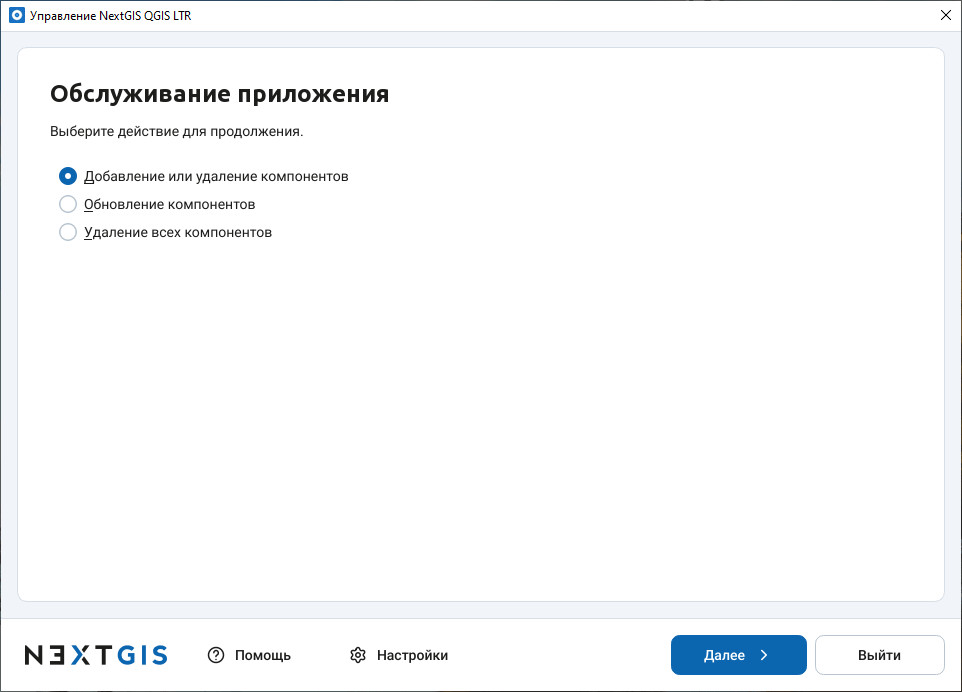
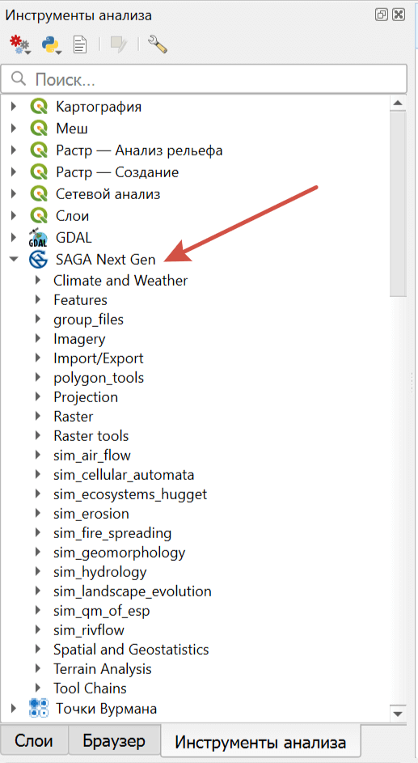

Установка SAGA в NextGIS QGIS
=============================

Начиная с версии 26 пакет инструментов SAGA GIS можно установить вместе с программой NextGIS QGIS. Отметьте "SAGA GIS" на втором шаге мастера установки (см. :numref:`install_wizard_recommended_pic`).

Если при установке программы вы не выбрали этот компонент, закройте все открытые окна NextGIS QGIS, запустите вновь установщик и перейдите к обслуживанию приложения.

   Обслуживание программы

Выберите **Добавление и удаление компонентов**. На следующем шаге наберите в поиске компонентов SAGA, отметьте нужный пункт галочкой и продолжите установку.

После этого инструменты SAGA должны появиться в панели анализа.

   Инструменты SAGA в панели инструментов анализа