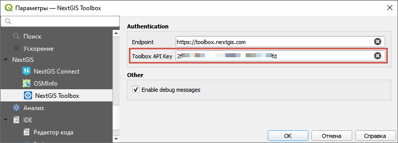

NextGIS Toolbox
================

С помощью этого модуля можно использовать инструменты из онлайн-коллекции `NextGIS Toolbox <https://toolbox.nextgis.com>`_ непосредственно из QGIS.

Установите модуль через меню Модули -> Управление модулями. Введите в строке поиска "NextGIS Toolbox", выберите модуль и нажмите **Установить**. После установки нужно будет перезапустить QGIS.

Инструменты из коллекции NextGIS Toolbox доступны в панели анализа и в меню Анализ.

API-ключ
--------

Чтобы запускать инструменты, вам понадобится API-ключ. Скопируйте его в `Настройках пользователя на сайте Toolbox <https://docs.nextgis.ru/docs_toolbox/source/settings.html>`_. Затем в NextGIS QGIS вставьте скопированный ключ в настройках модуля: Анализ -> NextGIS Toolbox -> Параметры.

   Ключ API в настройках модуля
