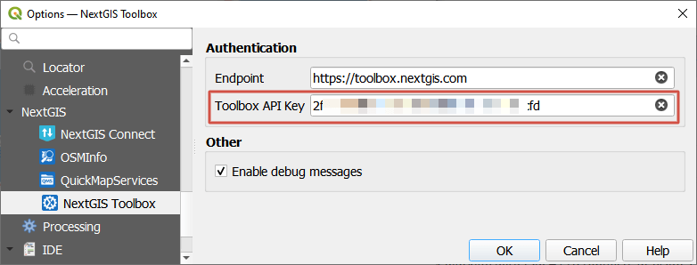

NextGIS Toolbox
================

This plugin allows to access the NextGIS tools collection, also available `online <https://toolbox.nextgis.com>`_, directly from QGIS.

To install the plugin, go to Plugins -> Manage and install plugins. Type "NextGIS Toolbox" and click **Install**. After installation you'll need to restart QGIS.

NextGIS Toolbox is available in the Processing panel as well as the Processing menu.

API key
--------

To use the tools you need to add your API key in the plugin settings.

Copy the API key from `Toolbox User settings <https://docs.nextgis.com/docs_toolbox/source/settings.html>`_.

In QGIS paste the copied key it in the plugin settings: Processing -> NextGIS Toolbox -> Settings.

   API key added to the plugin settings